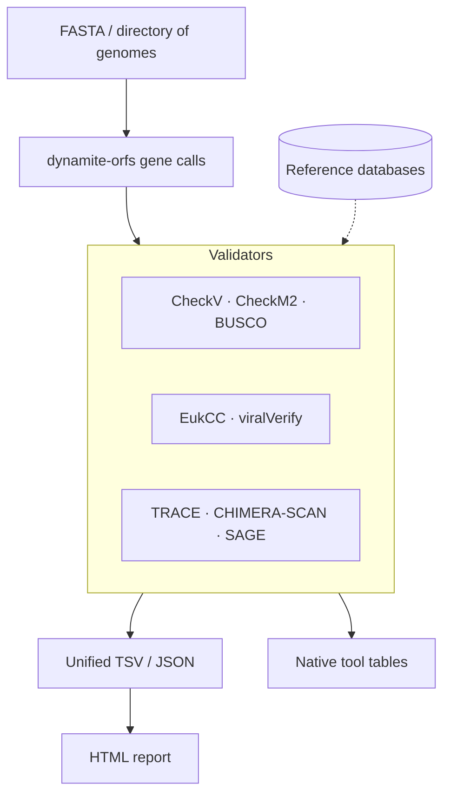

# 🛡️ Sentinel-X

### *Genome quality control for every domain of life — CheckV, CheckM2, BUSCO, EukCC and viralVerify in one pure-Rust binary.*

<div align="center">


### 🦠 Viral QC • 🧫 Prokaryotic QC • 🍄 Eukaryotic QC • 🧠 Reference-free Checks • 🚀 Parallelized Rust

</div>

```text
            .-.
            |█|            ____  _____ _   _ _____ ___ _   _ _____ _             __  __
           _|=|_          / ___|| ____| \ | |_   _|_ _| \ | | ____| |            \ \/ /
          |     |         \___ \|  _| |  \| | | |  | ||  \| |  _| | |     _____   \  /
          | (O) |          ___) | |___| |\  | | |  | || |\  | |___| |___ |_____|  /  \
          |     |         |____/|_____|_| \_| |_| |___|_| \_|_____|_____|        /_/\_\
          | (O) |        ──────────────────────────────────────────────────────────────
          |_____|         guarding the genome, base by base
```

---

# 🔬 What is Sentinel-X?

**Sentinel-X** (`sentinel-x`) is a single pure-Rust binary for genome quality control. It re-implements the scoring of five standard tools, adds three reference-free checks, and writes one table, one JSON and one HTML report for:

* 🦠 Viruses and phages
* 🧬 Proviruses
* 🧫 Bacteria
* 🌋 Archaea
* 🍄 Eukaryotes
* 🌍 Metagenomes and MAGs

No Python, HMMER, DIAMOND, Prodigal or LightGBM is needed at run time: the gene caller, the profile-HMM search, the protein search and the model evaluators are all built in. Genes are called once and shared by every validator.

---

# ✨ Features

<table>
<tr>
<td width="50%">

## 🔁 Re-implemented Validators

* **CheckV 1.1.1** — AAI/HMM completeness, proviruses, host contamination, DTR/ITR complete genomes, quality tiers, all CheckV tables
* **CheckM2 1.1.0** — 21,241 KEGG features, LightGBM and neural-network models, model selection, `quality_report.tsv`
* **BUSCO 6.1.0** — odb10 / odb12 / odb12.2 scoring, `full_table.tsv`
* **EukCC 2** — marker-set completeness and contamination (GA cutoffs)
* **viralVerify 1.1** — virus / plasmid / chromosome calls from Pfam domains

</td>
<td width="50%">

## 🧠 Reference-free Modules & Engines

* **TRACE** — terminal repeats and coding architecture for phages
* **CHIMERA-SCAN** — compositional junctions inside a contig
* **SAGE** — contigs that depart from a bin's core composition
* **HMMER engine** — hmmsearch 3.4 scoring, domains, GA/NC/TC
* **protsearch** — DIAMOND 2.1.9-compatible blastp, reads `.dmnd` in place
* **LightGBM evaluator** and CheckM2's neural network
* **dynamite-orfs** — Prodigal / prodigal-gv style gene calling

</td>
</tr>
</table>

---

# 🧪 Validators at a Glance

| Validator | Reproduces | Needs |
| --- | --- | --- |
| **CheckV** | CheckV 1.1.1: AAI and HMM completeness, host contamination and proviruses, complete genomes (DTR/ITR), quality tiers, all CheckV tables | CheckV database |
| **CheckM2** | CheckM2 1.1.0: 21,241 KEGG features, LightGBM general models, neural-network specific model, model selection, `quality_report.tsv` | CheckM2 DIAMOND database (models are embedded) |
| **BUSCO** | BUSCO 6.1.0 scoring for odb10, odb12 and odb12.2 datasets: Single / Duplicated / Fragmented / Missing, `full_table.tsv` | a BUSCO lineage |
| **EukCC** | EukCC 2 completeness/contamination from a marker set (GA cutoffs) | a selected marker HMM set |
| **viralVerify** | viralVerify 1.1 virus / plasmid / chromosome Naive Bayes on Pfam domains (`--cut_nc`) | Pfam-A |
| **TRACE** | terminal repeats and coding architecture for phages | — |
| **CHIMERA-SCAN** | compositional junctions inside a contig (inter-species chimeras) | — |
| **SAGE** | contigs of a bin that depart from its core composition | — |

---

# 🖼️ Example Outputs

<div align="center">

| Unified Table | HTML Report | Native Tool Tables |
| --- | --- | --- |
| 📋 One row per contig/genome per validator | 📊 Self-contained, sortable | 🧬 CheckV · CheckM2 · BUSCO · viralVerify formats |

</div>

```text
✔ Unified TSV and JSON
✔ Self-contained HTML report
✔ CheckV / CheckM2 / BUSCO / viralVerify native tables
✔ Checksum-verified database downloads
✔ Parallelized Rust backend
```

---

# ⚡ Why Sentinel-X?

| Feature | Sentinel-X |
| --- | --- |
| 🦀 One binary, one install | ✅ |
| 🚫 No Python / HMMER / DIAMOND / Prodigal at run time | ✅ |
| 🧬 Genes called once, shared by every validator | ✅ |
| 🎯 CheckV tables byte-identical with `--checkv-strict` | ✅ |
| 🎯 CheckM2 `quality_report.tsv` byte-identical on the same proteins | ✅ |
| 🔒 Checksum-verified, atomic database installs | ✅ |
| 🧠 Database-free TRACE / CHIMERA-SCAN / SAGE | ✅ |
| 🚀 Multi-threaded (rayon) | ✅ |
| 📊 Self-contained HTML report | ✅ |

---

# 🧱 Architecture



---

# 🦀 Tech Stack

| Component | Technology |
| --- | --- |
| Core engine | Rust (2021 edition, MSRV 1.75) |
| Parallelism | rayon |
| Gene calling | dynamite-orfs |
| Profile-HMM search | built-in HMMER 3.4-compatible engine |
| Protein search | built-in DIAMOND 2.1.9-compatible `protsearch` |
| Machine learning | built-in LightGBM evaluator + CheckM2 neural network |
| Large inputs | Cleaver-X |
| Cluster status | hydra-mpp |
| Assembly-statistics cross-check | rustyomestats (optional) |
| Archives / checksums | tar + flate2 / sha2 + md-5 |
| Serialization | serde + serde_json |
| Error handling | anyhow |

---

# 🚀 Installation

## 1️⃣ Install Rust

Sentinel-X needs Rust **1.75 or newer**. The apt toolchain on Ubuntu 24.04 is enough:

```bash
sudo apt install rustc cargo
```

or use rustup:

```bash
curl --proto '=https' --tlsv1.2 -sSf https://sh.rustup.rs | sh
rustup default stable
```

---

## 2️⃣ Install Sentinel-X

### From crates.io

```bash
cargo install sentinel-x --locked
```

### From source

```bash
git clone https://github.com/raw-lab/sentinel-x
cd sentinel-x

cargo build --release --locked      # → target/release/sentinel-x (~21 MB, models embedded)
./install.sh                        # build, then install to ~/.local/bin
PREFIX=/usr/local ./install.sh      # system-wide
```

### Prebuilt binary

Linux x86-64 (glibc ≥ 2.34): unpack `sentinel-x-0.2.0-x86_64-linux-gnu.tar.gz` and put `sentinel-x` on your `PATH`.

---

## 3️⃣ Optional Features

| Feature | Default | Effect |
| --- | --- | --- |
| `embed-models` | on | embed CheckM2's LightGBM and neural-network models (about 9 MB compressed) |
| `reads` | on | `--chunk-size`: stream huge FASTA files in chunks with [Cleaver-X](https://crates.io/crates/Cleaver-X) |
| `scale` | on | `cluster-status` for a [hydra-mpp](https://crates.io/crates/hydra-mpp) cluster |
| `rustyomestats` | off | cross-check assembly statistics with [rustyomestats](https://crates.io/crates/rustyomestats) on every run. Needs rustc ≥ 1.88 and pulls in polars, plotters and rust-bio (~220 crates) |

```bash
cargo build --release --features rustyomestats
```

---

## 4️⃣ Download Reference Databases

```bash
sentinel-x download all --lineage bacteria_odb12.2   # CheckV, CheckM2, Pfam-A and one BUSCO lineage
sentinel-x doctor --verify                           # status, checksums, readiness
```

Or one at a time:

```bash
sentinel-x download checkv                           # viral reference database
sentinel-x download checkm2                          # CheckM2 DIAMOND database
sentinel-x download busco --lineage bacteria_odb12.2
sentinel-x download pfam                             # for --viralverify
```

---

# ⚡ Quick Start

## 🦠 Viruses and Phages

One row per contig and validator:

```bash
sentinel-x run -i phages.fna -d virus -o viral.tsv --outdir viral_out -t 8
```

## 🧫 Bacterial or Archaeal Bins

A directory holds one genome per file:

```bash
sentinel-x run -i bins/ -d bacteria -o bins.tsv --outdir bins_out -t 16
```

## 🧬 Add BUSCO

```bash
sentinel-x run -i genome.fna -d bacteria --lineage bacteria_odb12.2 -o qc.tsv
```

## 🍄 Eukaryotes

```bash
sentinel-x run -i genome.fna -d eukaryote --markers markers.hmm --lineage eukaryota_odb12 -o euk.tsv
```

Every run that writes `-o out.tsv` also writes the HTML report `out.html`.

---

# 🧭 Domains

| `-d` | Unit | Always runs | Opt-in |
| --- | --- | --- | --- |
| `virus`, `mixed` | per contig | CheckV, TRACE, CHIMERA-SCAN | viralVerify (`--viralverify`) |
| `bacteria`, `archaea` | per genome | CheckM2, SAGE; CHIMERA-SCAN per contig | BUSCO (`--lineage`) |
| `eukaryote` | per genome | SAGE; CHIMERA-SCAN per contig | EukCC (`--markers`), BUSCO (`--lineage`) |

* viralVerify is opt-in because a Pfam-A search is the heaviest step.
* `auto` is accepted as an alias of `mixed`; Sentinel-X does not detect the domain.

---

# ⚙️ Main Options

```text
-i, --input <FASTA|DIR>   FASTA (.fa/.fna[.gz], gzip detected by content); a directory = one genome per file
-d, --domain <D>          virus | bacteria | archaea | eukaryote | mixed       [mixed]
    --db <DIR>            database root            [--db > $SENTINEL_X_DB > ~/.sentinel-x/db]
-o, --output <TSV>        unified table ("-" = stdout)                          [stdout]
    --json <PATH>         the same table as JSON
    --html <PATH>         HTML report        [default: next to -o; never for stdout or /dev/*]
    --no-html             do not write the automatic HTML report
    --outdir <DIR>        each tool's own tables (CheckV, CheckM2, BUSCO, viralVerify, SAGE)
-t, --threads <N>         threads for every stage (0 = all CPUs)                [1]
    --min-len <N>         drop contigs shorter than N
    --no-novel            skip TRACE / CHIMERA-SCAN / SAGE
virus / mixed:   --proteins <FAA>  --checkv-strict  --viralverify  --chunk-size <BYTES>
prokaryotes:     --ttable <N>  --ko <FILE>  --checkm2-comp <GBM> --checkm2-cont <GBM>
genome-level:    --lineage <NAME|DIR>  --genes (protein FASTA input)
eukaryote:       --markers <HMM>
```

`sentinel-x help` prints everything; `sentinel-x info` lists the engines and features.

---

# 📦 Output Files

Sentinel-X writes one unified table, its JSON twin, a self-contained HTML report and, with `--outdir`, each tool's own tables.

```text
out.tsv                         (-o)
├── One row per contig or genome per validator
├── contig_id · length · domain · validator · gene_count
├── completeness · contamination · quality · method · warnings
└── extra: key=value pairs separated by ";"

out.json                        (--json)
└── The same records, field order preserved

out.html                        (automatic, next to -o)
├── Summary: gauges for one genome or contig; tier distribution + medians for many
├── Statistics strip: size, contigs, N50, GC, coding density
├── Sortable results table (up to 5,000 rows)
├── Per-validator cards for small inputs; BUSCO / EukCC marker bars
└── Warnings tagged with validator and genome or contig

outdir/checkv/                  (--outdir)
├── quality_summary.tsv · completeness.tsv · contamination.tsv
├── complete_genomes.tsv · viruses.fna · proviruses.fna
└── tmp/gene_features.tsv · tmp/aai.tsv

outdir/checkm2/
├── quality_report.tsv
└── protein_files/<genome>.faa

outdir/busco/<genome>/
├── full_table.tsv
└── short_summary.txt

outdir/viralverify/
└── <input>_result_table.csv

outdir/sage/
└── <genome>.discordant_contigs.tsv
```

* `quality` is CheckV's tier for viruses and the MIMAG tier (completeness and contamination) for CheckM2 and EukCC.
* In `extra`, `;` and `=` inside values are written as `%3B` and `%3D`; `%` is written as `%25` only when two hex digits follow it.
* For SAGE, `contamination` is the discordant bp % (see below).

---

# 🧬 CheckV: Default vs `--checkv-strict`

CheckV 1.1.1 groups DIAMOND's output rows by contig on the assumption that they arrive in input order. DIAMOND ≥ 2.1 sorts them by query length under CheckV's settings, so CheckV computes AAI completeness per fragment of each contig and keeps the last fragment.

* **Default:** Sentinel-X uses all of a contig's hits.
* **`--checkv-strict`:** reproduces CheckV's tables exactly, bug included.

---

# 🗄️ Reference Databases

| Database | `sentinel-x download` | Source | Verified by |
| --- | --- | --- | --- |
| CheckV | `checkv` | `portal.nersc.gov/CheckV` (`CURRENT_RELEASE.txt`) | SHA-256 and size recorded (none published) |
| CheckM2 | `checkm2` | DOI `10.5281/zenodo.14897628` (DIAMOND DB v3, CheckM2 ≥ 1.1) | Zenodo MD5, `CONTENTS.json`, SHA-256 of the `.dmnd` |
| Pfam-A | `pfam` | EBI `current_release` | `md5_checksums` |
| BUSCO | `busco --lineage NAME` | `busco-data.ezlab.org/v5/data` (backup `busco-data2`) | MD5 from `file_versions.tsv` |

How installs work:

* Files download into `<root>/.staging/`, are verified and unpacked there, then moved into place atomically.
* A `.sentinel-x-complete.json` marker records each verified install.
* Failed transfers resume. A checksum failure triggers a fresh download.
* `sentinel-x download all [--lineage …]` fetches everything and skips what is already installed.
* DIAMOND databases are read in place; no conversion is needed. `sentinel-x convert` extracts a `.dmnd` to FASTA if you want one.
* For mirrors and offline tests, the URLs can be overridden with `SENTINEL_X_CHECKV_URL`, `SENTINEL_X_DOI_RESOLVER`, `SENTINEL_X_ZENODO_API`, `SENTINEL_X_PFAM_URL` and `SENTINEL_X_BUSCO_URL`. `SENTINEL_X_CHECKM2_SHA256` sets the expected `.dmnd` hash.

---

# 🧠 Reference-free Modules

These run without any database. They judge a sequence by its own composition and genes, so they report flags and indices, not reference-calibrated estimates.

* **TRACE** combines a CheckV-filtered terminal repeat (DTR/ITR), a head-to-tail k-mer overlap and the coding architecture (union coding density, largest gap). It returns a label: `complete`, `highly-complete`, `partial` or `fragment`.
* **CHIMERA-SCAN** tiles a contig into 5 kb windows and finds the best split into two segments.
  * It reports the junction strength D = 1 − cos(left mean profile, right mean profile) and flags D ≥ 0.12.
  * Calibration on complete chromosomes and inter-species junctions: 0.95 % false positives, 95.4 % sensitivity.
  * Phage–host junctions are usually invisible to composition; CheckV finds those.
* **SAGE** estimates the share of a bin's sequence that departs from its core tetranucleotide composition (contigs ≥ 5 kb), reported as `discordant_bp_pct`, and lists the discordant contigs.
  * On simulated MAGs it tracks the true contaminant fraction to within −1.2…+2.0 points.
  * It cannot see close relatives, and atypical plasmids or islands count as discordant.

---

# 📊 Validation at a Glance

<div align="center">

| Comparison | Result |
| --- | --- |
| 🦠 CheckV 1.1.1, `--checkv-strict` | `quality_summary` 46/46, `contamination` 46/46, `complete_genomes` 9/9, `aai` 150/150 byte-identical |
| 🧫 CheckM2 1.1.0, same proteins | `quality_report.tsv` byte-identical (6/6 genomes) |
| 🧫 CheckM2 1.1.0, own gene calls | completeness ±0.15, contamination ±0.44 points |
| 🧬 BUSCO 6.1.0 | 60/60 statuses on odb10, odb12 and odb12.2 |
| 🔍 viralVerify 1.1 | 46/46 on the same proteins, 45/46 end to end |
| ⚡ DIAMOND 2.1.9 (CheckM2 settings) | byte-identical output |

</div>

The parity tests used miniature reference databases. Full numbers are in [AUDIT.md](AUDIT.md) and [VALIDATION.md](VALIDATION.md).

---

# 🛠️ Other Commands

```bash
sentinel-x blastp -q q.faa -d db.dmnd --preset checkm2|checkv [-t N]   # DIAMOND-compatible tabular output
sentinel-x convert db.dmnd out.faa                                       # .dmnd → FASTA
sentinel-x doctor [--db DIR] [--build] [--verify]
sentinel-x cluster-status <addr> [port]                                  # feature `scale`
sentinel-x info | version | banner | help
```

---

# ⚖️ Differences

The main ones:

* **Gene calls differ from the reference callers.**
  * dynamite-orfs matches Prodigal coordinates for 94–100 % of genes in single mode, 87 % in meta mode, and 81 % against pyrodigal-gv. It does not mask N runs.
  * These differences cause most residual end-to-end differences. `--proteins` and `--genes` accept external gene calls.
* **EukCC** does no tree placement or marker-set selection.
* **BUSCO genome mode** uses Sentinel-X's gene calls.
* **The parity tests used miniature databases**, because the real hosts were unreachable from the build environment.

---

# 🧪 Testing

```bash
cargo test --release
```

Covers:

* CheckV rules: terminal repeats, host regions, AAI/HMM completeness, report formatting
* HMMER scores and coordinates against hmmsearch 3.4 fixtures
* `protsearch` output against DIAMOND 2.1.9 fixtures (CheckV and CheckM2 settings)
* CheckM2 features, KO counts, LightGBM and neural-network models, model selection
* BUSCO length rules and post-processing
* viralVerify classification and circularity
* Database discovery, checksums and safe archive extraction
* FASTA parsing, TSV escaping and the HTML report
* TRACE, CHIMERA-SCAN and SAGE on synthetic genomes

---

# 📄 License

**Creative Commons Attribution-NonCommercial (CC BY-NC 4.0)**

See the `LICENSE` file for details.

---

# 📖 Citation

If you use **Sentinel-X** in published work, please cite:

```text
White III RA et al.
Sentinel-X: unified pure-Rust genome quality control for viruses, bacteria, archaea and eukaryotes.
```

Sentinel-X re-implements published methods. Please also cite the original tools:

* **CheckV:** Nayfach et al. 2021, *Nat. Biotechnol.*
* **CheckM2:** Chklovski et al. 2023, *Nat. Methods*
* **BUSCO:** Manni et al. 2021, *Mol. Biol. Evol.*
* **EukCC:** Saary et al. 2020, *Genome Biol.*
* **viralVerify:** Antipov et al. 2020, *Bioinformatics*
* **HMMER:** Eddy 2011
* **DIAMOND:** Buchfink et al. 2021
* **Prodigal:** Hyatt et al. 2010
* **MIMAG:** Bowers et al. 2017

---

# 🤝 Contributing

We welcome:

* 🧬 New validators and QC metrics
* 🎯 Parity reports against the original tools
* ⚡ Performance optimizations
* 📊 Report and visualization improvements
* 🦀 Rust ecosystem integrations

Pull requests and issues are encouraged.

---

# 📞 Support

* 🐛 GitHub Issues:
  - **Issues:** [Sentinel-X Issues](https://github.com/raw-lab/sentinel-x/issues)

* 📧 Contact:
  - **Email:** [Dr. Richard Allen White III](mailto:rwhit101@charlotte.edu)
  - If you have any questions or feedback, please feel free to get in touch by email.  </br>

---

<div align="center">

# 🛡️ Sentinel-X

### *One binary. Every domain. Guarding the genome, base by base.*

Built with ❤️ in Rust.

</div>
